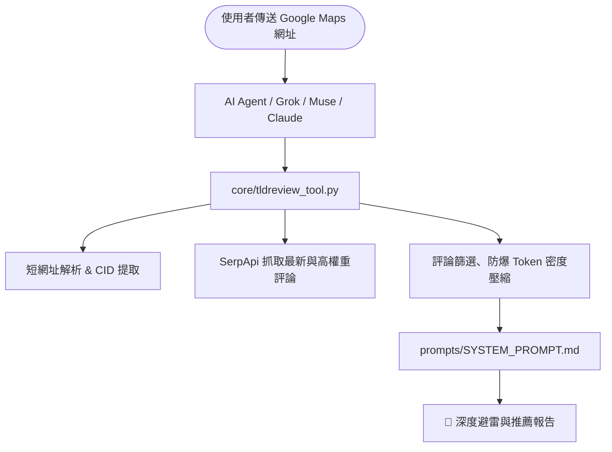

# 🦊 TL;DReview (Too Long; Didn't Review)

<div align="center">

**Turn messy Google Maps reviews into actionable, anti-hallucination intelligence for any AI Agent.**  
*一鍵將雜亂冗長的 Google Maps 評論，提煉成極具避雷價值與洞察深度的結構化報告。*

🌐 **[專案官網 (Official Website)](https://tldreview.app/)**

[](https://tldreview.app/)
[](LICENSE)
[](https://www.python.org/)
[](core/tldreview_tool.py)
[](CONTRIBUTING.md)

</div>

---

## 🦊 TL;DReview 是什麼？

**TL;DReview**（官網：[https://tldreview.app/](https://tldreview.app/)）是一個專為 AI Agent 與個人助手設計的評論分析工具。貼上 Google Maps 網址，它就會從數百則又長又雜的評論中，整理出一份結構化報告：**必點招牌、優點、缺點與避雷、內行人祕笈、營運規則、交通停車**，讓你在出發前就掌握一個地點的完整細節。

---

## 🆚 Google Maps 已經有評論摘要，為什麼還需要 TL;DReview？

Google Maps 的評論摘要最多只有三行，看完之後往往還是得回頭翻完整評論。


TL;DReview 會從眾多評論中過濾、整理出該地點的**優點、缺點、內行人祕笈**等分類內容，讓你快速掌握一間店的細節。

此外你還可以：
- 💬 **隨時追問 AI**：AI 會從評論中找出相關資料來回覆你。
- 🎛️ **自訂輸出分類**：直接請 AI 調整未來每次報告的內容分類方式，打造最貼近你需求的客製化體驗。

---

## 🤔 為什麼不直接把 Google Maps 網址丟給 AI 請它整理就好？

很多人第一時間會想：「*我直接把 Google Maps 連結貼給 ChatGPT / Claude / Grok，請它幫我整理評論不就好了嗎？*」  
實際上，直接丟網址給通用 AI 幾乎無法得到可靠的結果——因為從「一串網址」到「高品質避雷報告」之間，隔著大量通用 LLM 無法自行處理的工程細節：

| 環節 | 直接把網址丟給一般 AI | 使用 🦊 TL;DReview Skill |
| :--- | :--- | :--- |
| **1. 網址解析** | 短網址（`maps.app.goo.gl`）與跳轉頁面常無法解析，或誤抓網址內周邊地標的 ID。 | 自動解開短網址、IG 跳轉包裝與歐盟 Consent 攔截頁，精準分離出真正的店家 `CID / Place ID`。 |
| **2. 評論讀取** | Google Maps 評論由前端 JS 動態渲染且有防爬蟲限制，AI 內建瀏覽器只看得到空殼 HTML，**根本讀不到半則評論**。 | 透過結構化 API 直連，穩定抓取完整評論內文、發布時間、按讚數與 1~5 星分布數據。 |
| **3. 真實性與幻覺** | 讀不到評論時，AI 會偷偷去搜過時的「部落客業配食記」，甚至看店名**直接自行腦補菜色與口感**。 | **100% 綁定真實顧客評論證據（Evidence-Only）**，評論未提及的維度直接整段省略，絕不硬湊。 |
| **4. 評論品質過濾** | 就算手動複製貼上，前排也常被無意義短評或 5 年前的過時評價洗版，缺乏代表性。 | 演算法自動剔除 2 年前過期評論、優先提權**「在地嚮導 (Local Guides)」**、強制保留 **★1~★3 低星避雷負評**。 |
| **5. 揪出打卡刷評** | 一般 AI 只會照單全收高分評價，無法分辨 4.8 顆星是不是用「送小菜/飲料」洗出來的。 | 結合 1★~5★ 星級分布與內文偵測，一旦發現**「五星好評送獎品/折價」**，會在報告中**主動標註特別提醒**。 |
| **6. 跨國語系補齊** | 查國外餐廳時，若只看中文評論往往只有零星幾則，無法反映當地真實評價。 | 自動依地址推論**當地官方母語**抓取第一手評論；若評論數或在地嚮導數不足，**自動補抓英文評論並去重合併**。 |

### 🔧 TL;DReview 在背後幫你處理了哪些技術細節？

1. **🔗 Google Maps 短網址還原與精準 ID 剝離（URL Unwrapping & ID Disambiguation）**
   - 從手機 Google Maps App 分享出來的連結通常是 `maps.app.goo.gl/...`、`share.google/...`，或是從社群複製的 `l.instagram.com/?u=...` 包裝網址，甚至在部分雲端節點會被 `consent.google.com` 攔截。
   - 即使展開成長網址，Google Maps 參數（`data=!4m6!3m5...`）中也常同時混雜「連入來源地標（`!5s0x...`）」與「真正目標店家（`!1s0x...`）」的多組十六進位碼。本工具內建專用解析器，能優先鎖定 `!1s` CID、轉換十進位 `data_cid`、或提取 `ChI...` Place ID 與 `/g/...` 知識圖譜 ID，確保不會抓錯店。

2. **🧹 評論良莠不齊的多階段清洗演算法（Representative Curation）**
   - Google Maps 原始評論良莠不齊，充斥著好幾年前（甚至換老闆前）的過期評論，以及只有「好吃」「推」的無意義短評。
   - TL;DReview 在將資料餵給 AI 之前，會先執行多階段過濾以確保代表性：
     - **時效性過濾**：自動排除超過 **2 年以上**的陳舊評論（若近期評論不足 10 則才會自動向下遞補）。
     - **多維度代表性排序**：依序優先保留 **① 近 2 年在地嚮導（Local Guides）深度長評 ➔ ② ★1~★3 星的關鍵避雷負評（防止雷點被五星好評淹沒）➔ ③ 高按讚數（Helpful Likes）共識評論**。
     - **大樣本自動翻頁**：面對破 500 則評論的名店自動抓取第二頁擴充樣本，避免只看到表面前幾則評論。

3. **🚨 防止「打卡送獎品」刷五星好評：自動識別並特別提醒（Review Manipulation Radar）**
   - 許多餐廳、火鍋店或景點表面高達 4.7~4.9 顆星，實際上卻是靠「五星好評送肉盤／送飲料／折抵 50 元」洗出來的。
   - TL;DReview 透過雙重機制破解刷星陷阱：
     - **底層證據保留**：在篩選階段強制保留低星負評（常會揭露「大家都是為了換飲料才給五星」）並注入 **1★~5★ 星級分布數據**（一眼看穿「5 星極多、1 星也極多」的 M 型化異常）。
     - **Prompt 強制示警**：一旦在評論證據中偵測到「五星送小菜、打卡換贈品、評論折價」等行銷操作，AI 會在報告的「**💡 營運洞察與消費規則**」中**主動發出特別提醒**，幫你還原最真實的評價水位。

4. **🌍 搜尋國外餐廳的「當地母語路由 + 英文評論動態補齊」（Multi-Language Fallback）**
   - 當你去日本、韓國、泰國或歐洲旅遊找餐廳時，如果直接用使用者慣用語言（如中文）抓取，通常只抓得到極少數華人觀光客的留言，樣本嚴重失真。
   - TL;DReview 會先從店家的地址字串自動推論**當地官方語系**（支援全球 40+ 國，例如日本自動切換 `ja`、韓國切換 `ko`、法國切換 `fr`），直接撈取當地人最真實的母語評價。
   - **智慧二次補抓**：若該店總評論數夠多，但當地語系的近期「在地嚮導」評論少於 6 則（代表單一語系深度評論不足），系統會**自動發起第二次請求加抓英文（`en`）國際旅客評論**，並透過唯一 `review_id` 進行跨語系去重合併（避免同一則評論原文與翻譯重複入列），最後再由 AI 統一提煉並翻譯為你的慣用語言。

5. **✂️ 防爆 Token 預算與智慧標點斷句（Token Density Optimization）**
   - 把幾百則未處理的評論直接塞給 LLM，不僅極度浪費 Token，還會引發長文本的「Lost in the Middle（迷失於中間段落）」注意力衰退。
   - 本工具將輸入嚴格控制在最高資訊密度的 **30 則核心評論 / 8,000 字元上限**，且在截斷超長評論時採用**智慧標點斷句（Smart Truncation）**，優先在句號或驚嘆號處收尾，避免把關鍵的「菜名」或「價格」切成兩半。

---

## ✨ 核心特色

去餐廳、咖啡廳或熱門景點時，Google Maps 的星級常常被「五星打卡送小菜/折價券」灌水；數百則評論又長又雜，根本看不完。TL;DReview 的做法是：

1. **🛡️ 嚴格反幻覺（Anti-Hallucination）**：所有優勢、痛點、必點招牌必須 100% 來自真實評論證據；無證據的維度直接省略。
2. **🔍 評分操縱識別（Bias Detection）**：自動揪出「五星送飲料」等刷評行為，給出最客觀的避雷提醒。
3. **🚀 零依賴核心（Zero Dependencies）**：僅使用 Python 3 標準函式庫，任何 Linux VM、Docker 或 AI 沙盒免安裝套件即可秒級執行。
4. **🧩 全方位 Agent 支援**：已適配 **xAI Grok Bot**、**Meta Muse**、**Claude / Cursor (MCP)**、**LangChain / CrewAI**，並支援一鍵擴充。

---

## 🗺️ 架構與運作流程



---

## 🔑 使用前準備：取得 SerpApi API Key

TL;DReview 透過 [SerpApi](https://serpapi.com/) 抓取 Google Maps 評論，使用前請先：

1. 前往 [SerpApi Dashboard](https://serpapi.com/dashboard) 註冊帳號。
2. 在 Dashboard 取得你的 **API Key**。
3. 將 API Key 設定為環境變數 `SERPAPI_API_KEY`（或依各 Agent 整合指南設定為 Secret）。

> [!TIP]
> SerpApi 免費方案**每月可免費查詢 250 次**，個人使用通常綽綽有餘。

---

## ⚡ 支援的 AI Agent 快速開始

| 平台 / Agent | 整合方式 | 特色 | 指南連結 |
| :--- | :--- | :--- | :--- |
| **xAI Grok Bot** | Cloud Computer 附件 | 具備持久化沙盒、Secret 密鑰保護 | [👉 Grok 串接指南](integrations/grok/) |
| **Meta Muse** | Linux VM 沙盒 | 具備 Sentinel 安全連線提示 | [👉 Muse 串接指南](integrations/muse/) |
| **Claude / Cursor** | Model Context Protocol (MCP) | 一鍵掛載至本機 Claude Desktop / IDE | [👉 MCP 串接指南](integrations/mcp/) |
| **LangChain / CrewAI** | Python `@tool` 裝飾器 | 快速納入 Multi-Agent 鏈路 | [👉 LangChain 指南](integrations/langchain/) |
| **CLI / 本機終端** | 直接執行獨立腳本 | 支援 Markdown 與 JSON 輸出 | [👉 Core CLI 指南](#️-本機獨立執行-cli) |

---

## 📊 輸出報告預覽

```text
🦊 TL;DReview 深度報告：老張家常牛肉麵
📍 地址：台北市大安區新生南路一段
🏷️ 類型：麵食餐廳｜⭐ 4.3（共 1,820 則評價，分析 24 則核心評論）

---

🍜 必點招牌 / 核心亮點
・紅燒半筋半肉麵：牛筋燉至軟爛，腱子肉厚切入味，湯頭甘醇帶淡淡中藥香（極高共識）。
・自製花椒牛油：加半匙能大幅提升香氣與層次感。

👍 優勢與推薦點
・出餐節奏極快，客滿時入座約 5 分鐘即上桌。
・小菜選擇多元，涼拌小黃瓜與滷豆干深受好評。

👎 缺點與避雷提醒
・湯頭偏濃郁重鹹，平時清淡口味者建議請店家加清高湯。
・室內冷氣偏弱，炎夏用餐容易悶熱。

💡 營運洞察與消費規則
・僅收現金；內用每人低消 150 元。
・評論無五星贈品打卡跡象，評分真實可靠。

🤫 內行人的秘密撇步
・建議 11:45 前或 13:30 後前往，免排隊超過 15 分鐘。
・推薦選擇家常粗麵，比細麵更能掛住牛油香氣。

🚗 交通與停車指南
・捷運大安森林公園站 1 號出口步行 6 分鐘；建議停車於建國高架橋下。

🚨 特別點名
・老闆娘點餐步調緊湊，入座前建議先確認好麵型，避免猶豫被催促。
```

*(更多範例請參閱 [examples/sample_report.md](examples/sample_report.md))*

---

## 🛠️ 本機獨立執行 (CLI)

```bash
# 1. 設定 SerpApi API Key（可 export 環境變數，或直接複製 .env.example 為 .env 填入）
export SERPAPI_API_KEY="your_api_key_here"

# 2. 直接執行核心腳本（零依賴，免安裝任何第三方套件）
python3 core/tldreview_tool.py "https://maps.app.goo.gl/sample" --markdown

# 進階選項：指定排序（newest / lowest / highest）或開啟省額度模式（--save-quota，每次僅耗 1 點額度）
python3 core/tldreview_tool.py "https://maps.app.goo.gl/sample" --sort-by newest --save-quota --markdown

# 或輸出給其他程式使用的 JSON
python3 core/tldreview_tool.py "https://maps.app.goo.gl/sample"

# （選用）安裝為全域 CLI 指令 `tldreview`
pip install -e .
tldreview "https://maps.app.goo.gl/sample" --markdown
```

---

## 🤝 擴充與貢獻

想為其他 Agent（如 OpenAI Custom GPTs、Discord Bot、Telegram Bot 等）建立 Adapter？  
歡迎閱讀 [CONTRIBUTING.md](CONTRIBUTING.md) 提交 PR！

---

## 📄 License
本專案採用 [MIT License](LICENSE) 開源授權。
