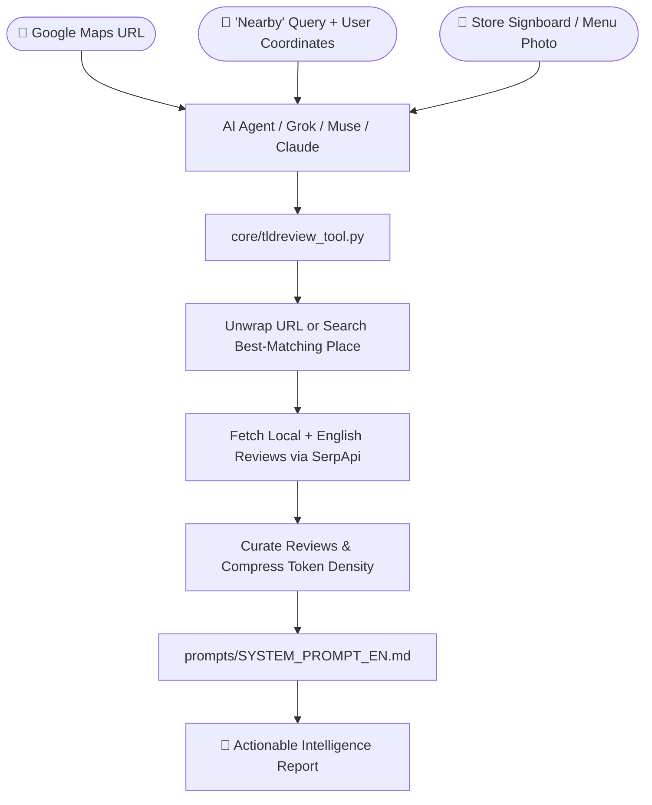

# 🦊 TL;DReview (Too Long; Didn't Review)

<div align="center">

**English** | **[繁體中文](README.zh-TW.md)**

**Turn messy Google Maps reviews into actionable, anti-hallucination intelligence for any AI Agent.**

🌐 **[Official Website (tldreview.app)](https://tldreview.app/)**

[](https://tldreview.app/)
[](#-whats-new-changelog)
[](LICENSE)
[](https://www.python.org/)
[](core/tldreview_tool.py)
[](https://buymeacoffee.com/tldreview)
[](CONTRIBUTING.md)

</div>

---

## 🆕 What's New (Changelog)

### 🧪 v3.0.0 (Beta / In Testing)
- 🔒 **Personal Dining Pocket List & Memory Vault (Beta / Testing)**:
  - **Save Places & Notes Naturally**: After reading a review summary, simply tell your AI: *"Save this to my wishlist"*, *"I ate here and loved it—note: ask for lighter broth next time"*, or *"Add this to my avoid list"*. Your AI saves the restaurant along with its **must-try dishes, red flags, insider tips, and your personal notes**!
  - **Ask What's Nearby for Free (0 Credits)**: Out in the city and hungry? Just ask: *"Is there anything on my wishlist near me right now?"* Your AI instantly checks your saved list against your GPS coordinates—**using 0 SerpApi credits**.
  - **No Sign-Up, Private by Default**: No accounts or passwords to register. The first time you save a place, TL;DReview automatically creates a private Sync Key (`TLDREVIEW_SYNC_KEY`) so your list stays end-to-end encrypted across chats and devices—even the cloud relay never sees what restaurants you saved (plus optional one-step export to **Obsidian** Markdown notes).

### 🚀 v2.0.0
- 💎 **Zero-Cost Metadata Extraction**: Maximizes SerpApi Place & Review payloads with **zero extra credit usage**:
  - ⏳ **Popular Times & Wait Time Integration**: Parses `popular_times` (Live Busyness, weekly peak hours, and average stay duration) to warn users about queues in `🤫 Insider Tips`.
  - 💰 **Price Level, Open State & Service Options**: Surfaces `price` (`$`–`$$$$` or spend range), `open_state` (open now, closing soon, temporarily closed), and `service_options` (dine-in, takeout, accessibility, cash-only) directly in the **Digest Header**.
  - 📋 **Latest Menu Photo & Price Extractor**: Extracts the newest 1–2 menu/price list photo URLs (`menu_urls`) from menu albums or recent reviews to prevent outdated price hallucinations.
- ⚔️ **Multi-Venue & Batch Workflows (`--compare` & `--top N`)**:
  - **Side-by-Side Comparison (`--compare`)**: Pass 2–3 venues to fetch in parallel with scaled token budgets (15 key reviews / 4,000 chars per venue) and generate a side-by-side comparison table (**Must-Try, Red Flags, Wait Time, Price, Best For**).
  - **Area Discovery + Auto-Audit (`--top 3`)**: Performs 1 LBS search, strips out `Sponsored` ads, audits the top $N$ nearby candidates in parallel for fake-review manipulation, and crowns the **🏆 True Organic Winner**.
- 🗣️ **Travel & Localization Enhancements**:
  - **Traveler's Point-and-Speak Card**: For cross-language lookups (`ja`, `ko`, `th`, `fr`, etc.), `🍜 Must-Try / Core Highlights` preserves original local-language dish names in parentheses—e.g., `Braised Pork Belly (豚の角煮)`—so travelers can point at their phone screen to order.
  - **Chinese Numeral & Brand Alias Normalization**: Normalizes Chinese numerals and store aliases (`五十嵐` ➔ `50嵐`, `85°C`, `7-ELEVEN`) for accurate nearby branch matching.

### 🎉 v1.1.0
- 📍 **"Nearby" & Natural-Language Store Search**: Ask directly for nearby stores (e.g., *"FamilyMart near me"* / *"附近的全家便利商店"*) using `--lat` and `--lng` coordinates.
- 📸 **Store Signboard & Menu Photo Lookup**: Resolve stores from signboard or menu photos via AI Vision and built-in zero-dependency EXIF GPS extraction (`--image`).
- 🧩 **Unified Agent & Tooling Upgrade**: Updated Core CLI, MCP Server, LangChain `@tool`, xAI Grok Bot, and Meta Muse integrations.

---

## 🦊 What is TL;DReview?

**TL;DReview** ([https://tldreview.app/](https://tldreview.app/)) is a Google Maps review extraction and intelligence engine built for AI Agents and personal assistants. It supports **six intuitive workflows**:
1. 🔗 **Paste any Google Maps URL** (including short links & social redirect wrappers)
2. 📍 **Ask for a "Nearby" Place** (e.g., *"FamilyMart near me"* / *"附近的全家便利商店"*—your AI Agent acquires your current coordinates, searches Google Maps, and jumps straight into the best-matching store's reviews)
3. 📸 **Send a Photo of a Store Signboard or Menu** (snap a storefront sign, menu, business card, or address plate—the AI extracts the store name/address and analyzes its reviews)
4. ⚔️ **Compare Multiple Venues Side-by-Side (`--compare`)** (compare 2–3 restaurants or cafes in a single table)
5. 🗺️ **Scan & Audit Top-N Nearby Places (`--top 3`)** (strip sponsored ads, audit fake reviews, and find the true organic winner nearby)
6. 🔒 **Personal Dining Pocket List Vault (`--vault-save` / `--vault-query`, 🧪 Beta)** (save places to your `wishlist`, `liked`, or `disliked` list with personal notes, and find nearby saved spots using 0 SerpApi credits)


No matter how you search, TL;DReview distills hundreds of noisy, lengthy reviews into a structured, evidence-backed briefing: **Must-Try Highlights, Strengths, Weaknesses & Red Flags, Insider Tips, Operational Rules, and Transit & Parking**—so you know everything that matters before you go.

---

## 🆚 Google Maps Already Has Review Summaries—Why TL;DReview?

Google Maps' built-in AI summary is at most three generic lines long, forcing you to scroll through dozens of raw reviews anyway.

TL;DReview filters and organizes reviews into actionable categories—**pros, cons, red flags, and insider tips**—giving you the complete picture at a glance.

Plus, because it runs inside your AI assistant, you can:
- 💬 **Ask Follow-Up Questions**: Ask the AI specific questions (e.g., *"Is it stroller-friendly?"* or *"How spicy is the broth?"*) and get answers grounded directly in the reviews.
- 🎛️ **Customize Output Categories**: Tell your AI to add or adjust report sections to match your personal preferences for every future query.

---

## 🤔 Why Not Just Paste a Google Maps URL Directly into an AI?

A common question is: *"Can't I just paste a Google Maps link into ChatGPT, Claude, or Grok and ask it to summarize the reviews?"*  
In practice, pasting a raw Google Maps URL into a general-purpose AI fails or produces unreliable summaries due to several engineering barriers that LLMs cannot solve on their own:

| Stage | Pasting a Raw URL into a General AI | Using the 🦊 TL;DReview Skill |
| :--- | :--- | :--- |
| **1. URL & Place Resolution** | Short links (`maps.app.goo.gl`) often fail, and general AIs can't resolve "nearby" coordinates to the exact closest branch ID. | Unwraps short links & consent walls, and supports **coordinate-based "nearby" search** plus **signboard/menu photo lookup** into the exact best-matching `CID / Place ID`. |
| **2. Reading Reviews** | Google Maps reviews are dynamically rendered via complex JS with strict anti-bot blocks. Built-in AI web fetchers only see an empty HTML shell and **cannot read a single review**. | Connects via structured API to reliably extract full review text, timestamps, helpful vote counts, and 1★–5★ rating distributions. |
| **3. Hallucination Risk** | When the AI can't read the reviews, it quietly falls back to searching outdated food blogs—or **hallucinates dishes and flavors out of thin air** based on the place's name. | **100% Evidence-Bound**: Every claim must come from fetched customer reviews. Sections without direct evidence are omitted entirely. |
| **4. Signal-to-Noise** | Even if you manually copy-paste reviews, the top results are often flooded with one-word spam or outdated 5-year-old comments. | Filters out reviews older than 2 years, prioritizes **Local Guides**, and **forcibly preserves ★1–★3 critical reviews** so red flags aren't buried. |
| **5. Fake 5-Star Radar** | General AIs take high star ratings at face value and can't tell if a 4.8★ rating was bought with freebies. | Combines 1★–5★ distribution data with text scanning to detect **"5-star review for a free drink/dish"** promos and **explicitly warns you in the report**. |
| **6. International Travel** | Searching a restaurant in Japan, Korea, or Europe in your native language yields only a handful of tourist reviews. | Automatically infers the **local official language** from the address to fetch native reviews, and **dynamically merges English reviews** when coverage is thin. |

### 🔧 What Technical Details Does TL;DReview Handle Under the Hood?

1. **🔗 Multi-Modal Entry: Short URL Unwrapping + Coordinate "Nearby" Search + Signboard/Menu Photo Lookup**
   - **Short URL & ID Disambiguation**: Automatically unwraps `maps.app.goo.gl/...`, `share.google/...`, `l.instagram.com/?u=...`, and `consent.google.com`, specifically targeting `!1s` destination CIDs while ignoring `!5s` referring landmarks.
   - **Coordinate-Based "Nearby" Search**: When you say *"FamilyMart near me"* (`附近的全家便利商店`), your AI Agent passes your current `(lat, lng)` coordinates to TL;DReview, which queries Google Maps, computes Haversine distances across branches, locks onto the best-matching nearby store, and immediately fetches its reviews.
   - **Signboard & Menu Photo Recognition**: When you send a photo of a store's **signboard (招牌), menu (菜單), or business card**, your AI Agent extracts the store name/address via Vision (coupled with built-in zero-dependency EXIF GPS extraction via `--image`) and jumps straight into the matched store's review digest.

2. **🧹 Multi-Stage Review Curation for True Representativeness**
   - Raw Google Maps reviews are noisy—filled with outdated feedback from years ago (often under previous management) and low-effort one-liners.
   - Before feeding data to the LLM, TL;DReview runs a deterministic curation pipeline:
     - **Recency Filter**: Excludes reviews older than **2 years** (automatically padding only if a location has fewer than 10 recent reviews).
     - **Priority Ranking**: Ranks reviews in strict order: **① Recent Local Guide deep-dives ➔ ② Critical ★1–★3 reviews (preventing red flags from being drowned out by 5-star praise) ➔ ③ High-like (`+helpful`) consensus reviews**.
     - **High-Volume Pagination**: Automatically fetches a second page for popular spots (>500 reviews) to broaden sample coverage.

3. **🚨 Anti-Manipulation Radar: Detecting "Check-In for Freebies" Fake 5-Star Reviews**
   - Many restaurants and attractions boast a 4.7★–4.9★ rating that is artificially inflated by *"Leave a 5-star review for a free drink / meat plate / discount"* promotions.
   - TL;DReview defeats rating inflation through a dual defense:
     - **Evidence Preservation**: By forcibly retaining ★1–★3 reviews and injecting the **1★–5★ rating distribution** into the prompt context, the AI can immediately spot bimodal (J-shaped / M-shaped) rating anomalies.
     - **Mandatory Alerting**: Whenever reviews mention check-in freebies or review-for-discount incentives, the system prompt mandates an **explicit warning under `💡 Operational Insights & Rules`**, giving you an honest read on the venue's true quality.

4. **🌍 Automatic Local-Language Routing & Multi-Language Fallback**
   - When researching restaurants abroad (e.g., in Japan, South Korea, Thailand, or France), querying only in your preferred summary language often returns just a few tourist reviews.
   - TL;DReview inspects the venue's address to infer its **local official language** (supporting 40+ countries—e.g., `ja` for Japan, `ko` for Korea, `fr` for France) to pull authentic first-hand local reviews.
   - **Smart Secondary Refetch**: If a venue has plenty of total reviews but fewer than 6 recent Local Guide reviews in the local language, TL;DReview **automatically triggers a secondary fetch in English (`en`)**, deduplicates across languages by `review_id` (so translated duplicates don't waste tokens), and lets the LLM synthesize everything into your preferred output language.

5. **✂️ Token Density Optimization & Smart Sentence Truncation**
   - Dumping hundreds of raw reviews into an LLM wastes tokens and triggers *"Lost in the Middle"* attention degradation.
   - TL;DReview caps context at the highest-density sweet spot (**max 30 curated reviews / 8,000 characters**) and uses **Smart Punctuation Truncation** to clip overly long reviews at natural sentence boundaries (`。！？.!?`), never slicing dish names or prices in half.

---

## ✨ Key Features

1. **🛡️ Strict Anti-Hallucination**: Every pro, con, and recommended dish is 100% grounded in real review excerpts; dimensions without evidence are cleanly omitted.
2. **🔍 Rating Manipulation Detection**: Automatically flags *"5-star review for freebies"* campaigns and skewed rating distributions.
3. **🚀 Zero-Dependency Core**: Built purely with the Python 3 standard library—runs out-of-the-box in any Linux VM, Docker container, or restricted AI sandbox without `pip install`.
4. **🧩 Universal Agent Compatibility**: Ready-to-use adapters for **xAI Grok Bot**, **Meta Muse**, **Claude / Cursor (MCP)**, and **LangChain / CrewAI**.

---

## 🗺️ Architecture & Workflow



---

## 🔑 Prerequisites: Get a SerpApi API Key

TL;DReview fetches structured Google Maps reviews via [SerpApi](https://serpapi.com/). Before starting:

1. Sign up at the [SerpApi Dashboard](https://serpapi.com/dashboard).
2. Copy your **API Key** from the dashboard.
3. Set it as the `SERPAPI_API_KEY` environment variable (or save it in a local `.env` file / Agent Secret).

> [!TIP]
> SerpApi's free tier includes **250 free searches per month**, which is plenty for personal use. You can also pass `--save-quota` to use strictly 1 credit per lookup.

---

## ⚡ Quick Start by AI Agent Platform

| Platform / Agent | Integration Method | Highlights | Guide |
| :--- | :--- | :--- | :--- |
| **xAI Grok Bot** | Cloud Computer Attachment | Persistent sandbox + encrypted Secret management | [👉 Grok Setup Guide](integrations/grok/) |
| **Meta Muse** | Linux VM Sandbox | Sentinel network allowlist integration | [👉 Muse Setup Guide](integrations/muse/) |
| **Claude / Cursor** | Model Context Protocol (MCP) | One-step mount into Claude Desktop / Cursor / IDEs | [👉 MCP Setup Guide](integrations/mcp/) |
| **LangChain / CrewAI** | Python `@tool` Decorator | Drop-in tool for multi-agent workflows | [👉 LangChain Guide](integrations/langchain/) |
| **CLI / Local Terminal** | Standalone Script / CLI | Supports Markdown and JSON output with 24h disk cache | [👉 Core CLI Guide](#️-standalone-cli-usage) |

---

## 📊 Sample Output Preview

```text
🦊 TL;DReview Digest: Lao Zhang Beef Noodle House
📍 Address: Sec. 1, Xinsheng S. Rd, Da'an District, Taipei City
🏷️ Type: Noodle Shop | ⭐ 4.3 (Total: 1,820 reviews, Analyzed: 24 key reviews)

---

🍜 Must-Try / Core Highlights
- Braised Half-Tendon Half-Beef Noodles: Tendon is melt-in-your-mouth tender, shank slices are thick and flavorful, and the broth has a rich herbal-beef sweetness (strong consensus).
- House Sichuan Pepper Beef Tallow: Adding half a spoonful dramatically elevates the aroma and depth of the soup.

👍 Strengths & Pros
- Lightning-fast service; bowls arrive within 5 minutes of ordering even during peak hours.
- Wide variety of side dishes—marinated cucumber and braised dried tofu are crowd favorites.

👎 Weaknesses & Red Flags
- Broth leans salty and heavy; diners who prefer lighter flavors should ask for extra clear broth.
- Air conditioning is weak indoors, making it stuffy during summer lunch rushes.

💡 Operational Insights & Rules
- Cash only (no credit cards or mobile payments); minimum spend of NT$150 per person for dine-in.
- No signs of "5-star review for freebies" promotions; rating is organic and trustworthy.

🤫 Insider Tips
- Arrive before 11:45 AM or after 1:30 PM to avoid waiting more than 15 minutes in line.
- Order the wide hand-cut noodles instead of thin noodles—they hold the spicy beef tallow aroma much better.

🚗 Transit & Parking
- 6-minute walk from MRT Daan Park Station (Exit 1); drivers should park under the Jianguo Elevated Road lot as the alley has no street parking.

🚨 Notable Callouts
- The owner takes orders at a brisk pace—decide on your noodle type and side dishes before sitting down to avoid feeling rushed.
```

*(See [examples/sample_report.md](examples/sample_report.md) and [prompts/SYSTEM_PROMPT_EN.md](prompts/SYSTEM_PROMPT_EN.md) for more details.)*

---

## 🛠️ Standalone CLI Usage

```bash
# 1. Set your SerpApi API Key (via export, or copy .env.example to .env)
export SERPAPI_API_KEY="your_api_key_here"

# 2A. Direct Google Maps URL (zero third-party dependencies)
python3 core/tldreview_tool.py "https://maps.app.goo.gl/sample" --lang en --markdown

# 2B. "Nearby" search with user coordinates (locks onto the closest best-matching store)
python3 core/tldreview_tool.py "FamilyMart near me" --lat 25.0330 --lng 121.5654 --lang en --markdown

# 2C. Store name / address search (or recognized by your AI Agent from a signboard/menu photo)
python3 core/tldreview_tool.py "Lao Zhang Beef Noodle Taipei Da'an" --lang en --markdown

# 2D. Direct signboard/menu photo input (extracts EXIF GPS automatically; uses GEMINI_API_KEY for CLI OCR)
python3 core/tldreview_tool.py --image ./signboard.jpg --lang en --markdown

# 2E. Side-by-Side Multi-Venue Comparison (--compare, scales token budget & fetches in parallel)
python3 core/tldreview_tool.py "Lin Dong Fang Beef Noodle" "Yong Kang Beef Noodle" --compare --lang en --markdown

# 2F. Area Discovery Top-N Scan + Anti-Manipulation Audit (--top 3, strips Sponsored ads & crowns organic winner)
python3 core/tldreview_tool.py "ramen near me" --lat 25.0330 --lng 121.5654 --top 3 --lang en --markdown

# 2G. Save / Update a Place in your Zero-Config E2EE Personal Dining Vault
python3 core/tldreview_tool.py --vault-save \
  --place-id "0x3442abcd1234:0x9876efgh" \
  --name "Lao Zhang Beef Noodle" \
  --lat 25.0330 --lng 121.5654 \
  --status wishlist \
  --tags "牛肉麵,大安區" \
  --must-try "紅燒半筋半肉麵,花椒牛油" \
  --red-flags "湯頭偏鹹" \
  --insider-tips "只收現金,11:45前到免排隊" \
  --user-notes "Take parents next time" \
  --markdown

# 2H. Query your Personal Dining Vault by status, keyword, or GPS proximity (0 SerpApi credits!)
python3 core/tldreview_tool.py --vault-query --status wishlist --lat 25.0335 --lng 121.5640 --radius-km 3.0 --markdown

# Advanced options: sort order (newest / lowest / highest) or quota-saving mode (--save-quota)
python3 core/tldreview_tool.py "https://maps.app.goo.gl/sample" --lang en --sort-by newest --save-quota --markdown

# Output structured JSON for downstream pipelines
python3 core/tldreview_tool.py "https://maps.app.goo.gl/sample" --lang en

# (Optional) Install globally as the `tldreview` CLI command
pip install -e .
tldreview "FamilyMart near me" --lat 25.0330 --lng 121.5654 --lang en --markdown
```

---

## 🔒 Personal Dining Pocket List Vault (🧪 Beta / In Testing)

Ever look up a great restaurant with your AI, only to forget what to order—or which places to avoid—a week later? Now your AI can remember your personal dining list for you:

- 📌 **Save & Categorize with One Sentence**: Tell your AI to bookmark a spot to your **Wishlist (`wishlist`)**, mark a favorite spot as **Liked (`liked`)**, or put a tourist trap on your **Avoid List (`disliked`)**—complete with its must-try dishes, insider tips, and your own personal notes.
- 📍 **Instant "What's on My Wishlist Nearby?" Lookup (0 Credits)**: Hungry while walking around? Ask *"Is there anything on my wishlist near me?"* and TL;DReview instantly filters your saved spots by distance—**without spending a single SerpApi credit**.
- 🔐 **No Sign-Up, 100% Private**: No accounts required. On your first save, TL;DReview automatically generates a private Sync Key (`TLDREVIEW_SYNC_KEY`). Your list is encrypted on your device before syncing to the cloud, so nobody—not even the server—can see your saved places.
- 📝 **Obsidian Note Export**: Use Obsidian? Set `TLDREVIEW_OBSIDIAN_DIR` to automatically save a neatly formatted Markdown card for every restaurant in your vault.

> [!NOTE]
> 🧪 **Beta Notice**: The Personal Dining Vault is currently in **v3.0.0 Beta testing**. Feedback and suggestions are welcome!


---

## 🤝 Contributing

Want to build an adapter for another platform (OpenAI Custom GPTs, Discord, Telegram, Dify, Coze, etc.)?  
Check out [CONTRIBUTING.md](CONTRIBUTING.md) and open a Pull Request!

---

## ☕ Support & Sponsor

If **TL;DReview** saves you time and helps you dodge tourist traps, consider buying us a coffee to support ongoing development:  
👉 **[Buy Me a Coffee (https://buymeacoffee.com/tldreview)](https://buymeacoffee.com/tldreview)**

[](https://buymeacoffee.com/tldreview)

---

## 📄 License

Licensed under the [MIT License](LICENSE).
