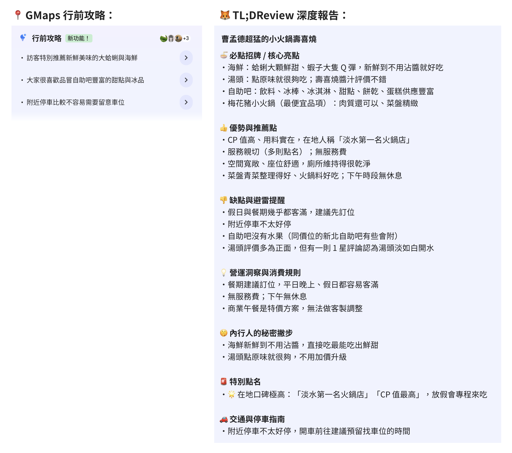

# 🦊 TL;DReview (Too Long; Didn't Review)

<div align="center">

**[English](README.md)** | **繁體中文**

**Turn messy Google Maps reviews into actionable, anti-hallucination intelligence for any AI Agent.**  
*一鍵將雜亂冗長的 Google Maps 評論，提煉成極具避雷價值與洞察深度的結構化報告。*

🌐 **[專案官網 (Official Website)](https://tldreview.app/)**

[](https://tldreview.app/)
[](#-版本更新紀錄-whats-new)
[](LICENSE)
[](https://www.python.org/)
[](core/tldreview_tool.py)
[](https://buymeacoffee.com/tldreview)
[](CONTRIBUTING.md)

</div>

---

## 🆕 版本更新紀錄 (What's New)

### 🧪 v3.0.0（新功能測試中 Beta）
- 🔒 **個人美食口袋名單與記憶金庫（測試中 Beta）**：支援用一句話把餐廳分類存入 **「📌 想去 (`wishlist`)」**、**「❤️ 去了很喜歡 (`liked`)」** 或 **「💣 踩雷黑名單 (`disliked`)」**，並支援自訂標籤、免註冊端到端加密同步與 **0 額度消耗**查詢附近已存好店（詳見下方[使用指南](#-個人美食口袋名單金庫-測試中-beta)）。

### 🚀 v2.0.0
- 💎 **零成本結構化情報提取**：不額外消耗額度，自動提取 **⏳ 排隊與尖峰時段預警**、**💰 均消價位與即時營業狀態**，以及 **📋 最新菜單/價目表照片**。
- ⚔️ **多店 PK（`--compare`）與 🗺️ 區域探索（`--top 3`）**：支援 2～3 間餐廳平行抓取並輸出橫向對比表；或掃描附近前 3 名、自動剔除廣告並推薦「🏆 真正零刷評」冠軍店家。
- 🗣️ **外國旅遊「點餐手指卡」**：跨語系查詢（日/韓/泰/法文等）自動於必點菜色保留**當地語言原名對照**（如 `炙燒和牛握壽司 (炙り和牛握り)`），出國直接指螢幕即可點餐；並修正台灣連鎖店中文數字比對（如 `五十嵐` ➔ `50嵐`）。

### 🎉 v1.1.0
- 📍 **「附近店家」座標搜尋與 📸 招牌／菜單照片查詢**：支援直接說「*附近的全家便利商店*」或傳送招牌/菜單照片（含 EXIF GPS 提取）鎖定最近分店。

---

## 🦊 TL;DReview 是什麼？

**TL;DReview**（[https://tldreview.app/](https://tldreview.app/)）是專為 AI Agent 打造的 Google Maps 深度探店與避雷工具。支援 **6 種直覺用法**：
1. 🔗 **貼上 Google Maps 網址**：直接解析短網址與地標，抓取真實評論。
2. 📍 **直接說「附近的店家」**：如「*附近的全家便利商店*」，結合你的座標自動鎖定最近分店。
3. 📸 **傳送招牌或菜單照片**：拍下店門招牌、菜單或名片，自動辨識店名與地址直入評論。
4. ⚔️ **多店 PK 橫向比較（`--compare`）**：猶豫兩三間餐廳時，直接產出「必點、雷點、排隊、價格、適合誰」對比表。
5. 🗺️ **區域探索防洗分掃描（`--top 3`）**：問「*附近有什麼好吃的拉麵且不踩雷？*」，自動剔除廣告並找出真正零刷評冠軍。
6. 🔒 **個人美食口袋名單金庫（`--vault-save` / `--vault-query`，🧪 測試中）**：把好店存進「想去 / 去了很喜歡 / 黑名單」，隨時查附近口袋名單且不扣額度。

---

## 🆚 為什麼需要 TL;DReview？（對比 Google Maps 摘要與一般 AI）

Google Maps 內建摘要最多只有三行空泛描述；而若直接把 Google Maps 網址貼給一般 AI（ChatGPT / Claude / Grok），又會遇到網頁防爬蟲與嚴重腦補問題：



| 環節 | 直接把網址丟給一般 AI | 使用 🦊 TL;DReview |
| :--- | :--- | :--- |
| **1. 評論讀取與防幻覺** | Google Maps 由動態 JS 渲染，AI 讀不到評論會偷搜過時食記，甚至**看店名自己腦補菜色**。 | 透過 API 抓取完整評論與星級分布；**100% 綁定真實評論證據**，未提及的項目直接省略。 |
| **2. 評論品質清洗** | 就算手動複製貼上，前排也常被「好吃」短評或 5 年前（換老闆前）的舊評價洗版。 | 自動剔除 2 年前舊評，優先排序 **① 在地嚮導長評 ➔ ② ★1~★3 關鍵負評 ➔ ③ 高讚數共識**。 |
| **3. 破解打卡洗五星** | 一般 AI 看到 4.8★ 就照單全收，分不出是不是「五星好評送肉盤/飲料」洗出來的。 | 自動偵測評論內文與 M 型星級分布，若有刷評送贈品活動會在報告中**主動標註示警**。 |
| **4. 出國旅遊母語路由** | 查日本、韓國、歐洲餐廳若只抓中文，只有零星觀光客留言。 | 自動依地址切換**全球 40+ 國當地母語**抓取第一手評論（不足時動態補抓英文），並附上**點餐手指卡**。 |
| **5. 營業與漲價防呆** | 常引用幾年前的舊價格，或衝過去才發現公休、只收現金。 | 開頭直接顯示**均消價位、即時營業狀態、熱門排隊時段**與**最新菜單圖片連結**。 |

---

## 🔒 個人美食口袋名單金庫（🧪 測試中 Beta）

每次請 AI 查完餐廳，過幾天就忘記哪家必點什麼、哪家是雷店嗎？現在你可以直接用說的，讓 AI 幫你把餐廳分門別類記下來：

### 1️⃣ 三種收藏分類（支援自動升級狀態）

| 分類狀態 (`status`) | 代表意義 | 你可以這樣跟 AI 說（口語範例） |
| :--- | :--- | :--- |
| 📌 **`wishlist`（想去清單）** | 還沒去過、看完報告想先收藏 | *「幫我把這家存進**想去清單**，備註：下次帶爸媽去吃」* |
| ❤️ **`liked`（去了很喜歡）** | 實際吃過很推，記錄心得與個人評分 | *「這家我今天去吃了**很喜歡**！幫我改到喜歡清單、給 4.8 顆星，筆記：半筋半肉必點、湯頭要請老闆做淡一點」* |
| 💣 **`disliked`（踩雷黑名單）** | 吃過覺得不行，提醒自己別再踩坑 | *「這家我去吃過太雷了，幫我移到**黑名單**，備註：肉太柴又貴」* |

- **✨ 智慧狀態升級（資料自動合併）**：當你去吃了原本在「📌 想去 (`wishlist`)」的店，並告訴 AI「*我去吃過了很喜歡 (`liked`)*」時，系統會自動將狀態升級為 `liked`、壓上造訪日期與你的個人評分，同時**完整保留**當初存下來的必點招牌、內行撇步與舊筆記！
- **🏷️ 自訂主題標籤（`--tags`）**：除了上述三種狀態，你還可以幫店家加上任意標籤，例如：`長輩友善`、`約會餐廳`、`深夜食堂`、`牛肉麵`、`大安區`。

### 2️⃣ 怎麼查詢你的口袋名單？（完全不扣 SerpApi 額度！）
你可以隨時請 AI 幫你從金庫裡翻找名單（在本地直接解密並計算距離，**消耗 0 點查詢額度**）：
- **找附近「想去還沒去」的店**：*「我現在附近有沒有之前存過『想去』的餐廳？」*
- **找「去過很喜歡」的愛店二訪**：*「幫我列出我之前去過覺得『很喜歡』、而且有『長輩友善』標籤的店」*
- **避開黑名單**：*「幫我看看我的避雷黑名單有哪些店？」*

### 3️⃣ 一句話密語託管 (Passphrase Escrow)、跨裝置復原 & 安全模型
由於許多使用者是在雲端 AI 沙盒（如 Meta Muse / Grok VM）中操作，當容器重置或換電腦時，要求使用者手動去翻找 `~/.tldreview/sync.key` 並不切實際。因此 v3.0.0 內建了與 iCloud 鑰匙圈 / Signal PIN 同概念的 **Passphrase Escrow（一句話密語託管）**：

- 🗣️ **用一句話託管與復原金鑰（全程對話完成，不需終端機）**：
  - **對話內直接設定**：告訴 AI *「幫我設定同步密碼」*，AI 會誠實告知密語會留在對話記錄中，並請你提供一句好記的話（如 *「我阿嬤煮的紅燒牛肉麵最香」*）。AI 在背景執行 `--vault-escrow --passphrase "..."`，回報成功時**絕不重複貼回密語**，只提供公開的 `escrow_id`。
  - **換裝置或 VM 重置後一鍵找回**：在新環境只要把當初這句話告訴新的 AI（背景執行 `--vault-recover --passphrase "..."`），就能自動取回並解開金鑰，把雲端所有口袋清單完整同步回來！
  - **有疑慮時的終端機替代方案**：若對密語留在對話中有疑慮，也可直接在本機終端機執行 `python3 core/tldreview_tool.py --vault-escrow --passphrase "<密語>"`，密語全程不經任何對話與網路對話模型。
- 🛡️ **拒絕「靜默死亡」與平行金庫**：系統將非機密的 `~/.tldreview/vault_id` 與機密的 `~/.tldreview/sync.key`（權限 `0600`）分開保存。若金鑰檔案遺失或損毀，系統會**明確報錯中止**並引導你使用密語復原，絕不會偷偷產生第二把新金鑰導致與舊資料失聯。同時支援 `--vault-export` / `--vault-import` 匯出明文 JSON 備份。
- 🔍 **誠實的安全邊界與耐久性約定（Threat Model & Durability Contract）**：
  - **防範範圍（連雲端伺服器也看不到）**：餐廳名單在離開執行環境前即完成端到端加密（E2EE），Cloudflare Worker 與 KV 資料庫只看得到密文，即使雲端資料庫外洩也不會洩露你的口袋清單。
  - **Agent 代管定位（Agent-as-Custodian）**：在 AI Agent 沙盒中，Agent 為執行加解密必須持有金鑰，且本地快取 `~/.tldreview/vault.json` 為明文儲存；因此 Agent 本身就是金庫的監護人，復原密語是「備用鑰匙」而非「不能讓 Agent 知道的秘密」。對美食金庫而言，對話記錄是合理的備用鑰匙存放處（但此模式**不可**套用於銀行密碼等高敏感場景）。
  - **密語託管的誠實限制**：① 弱密語可能遭離線暴力猜測，因此系統強制要求密語強度、採用高成本 `scrypt` KDF，並在雲端對取回託管區塊實施嚴格限流（每分鐘最多 5 次）；② **忘記復原密語且無金鑰備份等於永久無法解密雲端資料**，沒有任何客服能重設（這與 Signal PIN、1Password Secret Key 是相同的真正 E2EE 取捨）。
- 📝 **Obsidian 自動匯出**：若有使用 Obsidian，設定環境變數 `TLDREVIEW_OBSIDIAN_DIR=/你的/Obsidian路徑`，每次存店就會自動匯出排版精美的 Markdown 餐廳筆記卡！

> [!NOTE]
> 🧪 **狀態說明**：個人美食口袋名單金庫目前為 **v3.0.0 Beta 測試中功能**，歡迎試用並提供回饋！

---

## 🔑 使用前準備 & AI Agent 快速串接

1. 前往 [SerpApi Dashboard](https://serpapi.com/dashboard) 免費註冊並取得 **API Key**（免費方案**每月可查 250 次**，查詢個人口袋名單則完全不扣額度）。
2. 將金鑰設為環境變數 `SERPAPI_API_KEY`，或依下方指南掛載至你的 AI 助手：

| 平台 / Agent | 整合方式 | 特色 | 指南連結 |
| :--- | :--- | :--- | :--- |
| **xAI Grok Bot** | Cloud Computer 附件 | 持久化沙盒、Secret 密鑰保護 | [👉 Grok 串接指南](integrations/grok/README.zh-TW.md) |
| **Meta Muse** | Linux VM 沙盒 | Sentinel 安全連線白名單 | [👉 Muse 串接指南](integrations/muse/README.zh-TW.md) |
| **Claude / Cursor** | Model Context Protocol (MCP) | 一鍵掛載至 Claude Desktop / IDE | [👉 MCP 串接指南](integrations/mcp/README.zh-TW.md) |
| **LangChain / CrewAI** | Python `@tool` 裝飾器 | 快速納入 Multi-Agent 工作流 | [👉 LangChain 指南](integrations/langchain/README.zh-TW.md) |
| **CLI / 本機終端** | 零依賴獨立腳本 | 支援 Markdown 與 JSON 輸出 | [👉 見下方 CLI 指令](#️-本機獨立執行-cli) |

---

## 📊 輸出報告預覽

```text
🦊 TL;DReview 深度報告：老張家常牛肉麵
📍 地址：台北市大安區新生南路一段
🏷️ 類型：麵食餐廳｜⭐ 4.3（共 1,820 則評價，分析 24 則核心評論）
💰 均消/價位：$200–400｜🕒 營業狀態：營業中 · 21:00 打烊
🛎️ 服務與設施：內用 | 外帶 | 只收現金

---

🍜 必點招牌 / 核心亮點
・紅燒半筋半肉麵：牛筋燉至軟爛，腱子肉厚切入味，湯頭甘醇帶淡淡中藥香（極高共識）。
・自製花椒牛油：加半匙能大幅提升香氣與層次感。

👍 優勢與推薦點
・出餐節奏極快，客滿時入座約 5 分鐘即上桌；涼拌小黃瓜與滷豆干深受好評。

👎 缺點與避雷提醒
・湯頭偏濃郁重鹹，平時清淡口味者建議請店家加清高湯；炎夏室內冷氣偏弱。

💡 營運洞察與消費規則
・僅收現金；內用每人低消 150 元。評論無五星贈品打卡跡象，評分真實可靠。

🤫 內行人的秘密撇步
・週六 12:00–14:00 為最高峰，建議 11:45 前或 13:30 後前往免排隊；推薦選家常粗麵更能掛湯。

🚗 交通與停車指南
・捷運大安森林公園站 1 號出口步行 6 分鐘；開車建議停建國高架橋下停車場。

---
💡 想把這間店加入您的「📌 想去清單 (wishlist)」或標記為「❤️ 喜歡 (liked) / 💣 避雷 (disliked)」嗎？隨時告訴我即可為您加密儲存！
```

*(更多範例請參閱 [examples/sample_report.zh-TW.md](examples/sample_report.zh-TW.md))*

---

## 🛠️ 本機獨立執行 (CLI)

```bash
export SERPAPI_API_KEY="your_api_key_here"

# 1. 貼網址查詢 / 「附近店家」座標查詢 / 招牌或菜單照片查詢
python3 core/tldreview_tool.py "https://maps.app.goo.gl/sample" --markdown
python3 core/tldreview_tool.py "附近的全家便利商店" --lat 25.0330 --lng 121.5654 --markdown
python3 core/tldreview_tool.py --image ./signboard.jpg --markdown

# 2. 多店 PK 橫向比較 (--compare) / 區域探索 Top-3 防洗分掃描 (--top 3)
python3 core/tldreview_tool.py "林東芳牛肉麵" "永康牛肉麵" --compare --markdown
python3 core/tldreview_tool.py "附近好吃的拉麵" --lat 25.0330 --lng 121.5654 --top 3 --markdown

# 3. 個人美食口袋名單：存進「想去清單 (wishlist)」(--vault-save)
python3 core/tldreview_tool.py --vault-save \
  --name "老張牛肉麵" --lat 25.0330 --lng 121.5654 \
  --status wishlist \
  --tags "牛肉麵,大安區,長輩友善" \
  --must-try "紅燒半筋半肉麵,花椒牛油" \
  --user-notes "下次帶爸媽去吃，湯頭請老闆做淡一點" --markdown

# 4. 個人美食口袋名單：吃過後升級為「去了很喜歡 (liked)」並加上個人評分
python3 core/tldreview_tool.py --vault-save \
  --name "老張牛肉麵" --status liked --user-rating 4.8 \
  --user-notes "爸媽很愛半筋半肉！" --markdown

# 5. 查詢附近 3 公里內的「想去清單」或「喜歡名單」（消耗 0 點 SerpApi 額度！）
python3 core/tldreview_tool.py --vault-query --status wishlist --lat 25.0335 --lng 121.5640 --radius-km 3.0 --markdown
python3 core/tldreview_tool.py --vault-query --status liked --tag "長輩友善" --markdown

# 6. 設定「一句話復原密語」託管金鑰 (--vault-escrow) 與跨裝置/VM 重置後一鍵復原 (--vault-recover)
python3 core/tldreview_tool.py --vault-escrow --passphrase "我阿嬤煮的紅燒牛肉麵最香" --markdown
python3 core/tldreview_tool.py --vault-recover --passphrase "我阿嬤煮的紅燒牛肉麵最香" --markdown

# 7. 金庫連線與狀態診斷 (--vault-status) / 匯出與匯入明文備份 (--vault-export / --vault-import)
python3 core/tldreview_tool.py --vault-status --markdown
python3 core/tldreview_tool.py --vault-export ./my_dining_backup.json
python3 core/tldreview_tool.py --vault-import ./my_dining_backup.json --markdown
```

---

## 🤝 擴充貢獻與贊助支持

- **貢獻 Adapter**：歡迎閱讀 [CONTRIBUTING.zh-TW.md](CONTRIBUTING.zh-TW.md) 提交 PR！
- **請我們喝杯咖啡**：如果 **TL;DReview** 幫你省下翻評論的時間、成功避開地雷店，歡迎贊助支持專案持續開發：  
  👉 **[Buy Me a Coffee (https://buymeacoffee.com/tldreview)](https://buymeacoffee.com/tldreview)**

[](https://buymeacoffee.com/tldreview)

---

## 📄 License
本專案採用 [MIT License](LICENSE) 開源授權。
