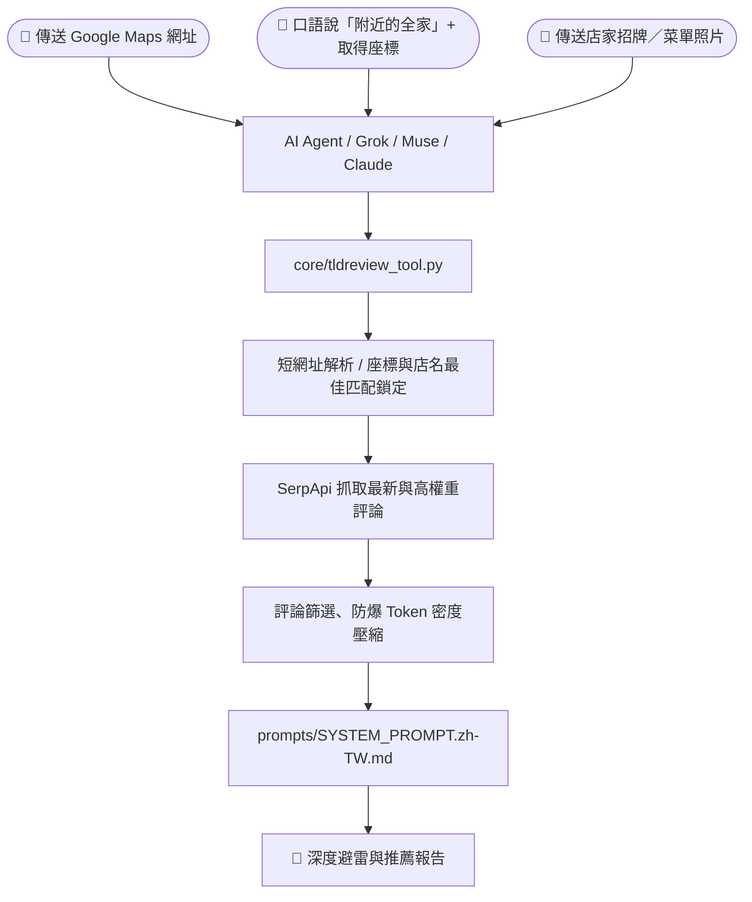

# 🦊 TL;DReview (Too Long; Didn't Review)

<div align="center">

**[English](README.md)** | **繁體中文**

**Turn messy Google Maps reviews into actionable, anti-hallucination intelligence for any AI Agent.**  
*一鍵將雜亂冗長的 Google Maps 評論，提煉成極具避雷價值與洞察深度的結構化報告。*

🌐 **[專案官網 (Official Website)](https://tldreview.app/)**

[](https://tldreview.app/)
[](#-版本更新紀錄-whats-new)
[](LICENSE)
[](https://www.python.org/)
[](core/tldreview_tool.py)
[](https://buymeacoffee.com/tldreview)
[](CONTRIBUTING.md)

</div>

---

## 🆕 版本更新紀錄 (What's New)

### 🧪 v3.0.0（新功能測試中 Beta）
- 🔒 **專屬你的「AI 美食口袋名單與記憶金庫」（測試中 Beta）**：
  - **用說的就能存店、記筆記**：看完探店報告覺得心動？直接跟 AI 說「*幫我把這家存進想去清單*」、「*這家我吃過超推，筆記：下次帶爸媽去、湯頭做淡一點*」，或是「*這家太雷了，幫我放進黑名單*」。AI 會連同店家的**必點招牌、避雷提醒、內行撇步**一起幫你記下來！
  - **走到哪問到哪，完全不扣額度**：出門在外不知道吃什麼時，只要問 AI：「*我現在附近有沒有之前存過想去的店？*」AI 就會根據你的位置，一秒從你的口袋名單中挑出離你最近的餐廳，而且**完全不消耗 SerpApi 查詢額度**。
  - **免註冊帳號、隱私全加密**：不用註冊任何帳號，第一次存店時系統會自動幫你產生一組專屬同步通行證（`TLDREVIEW_SYNC_KEY`）。你的口袋名單在離開裝置前就會完成端到端加密（E2EE），就算跨對話或換裝置同步，雲端也完全看不到你存了哪些私房名單（亦支援自動匯出至 Obsidian 筆記）。

### 🚀 v2.0.0
- 💎 **Google Maps 結構化元數據最大化利用（Zero-Cost Metadata Extraction）**：不額外消耗 SerpApi Credit，直接從回應中提取關鍵情報：
  - ⏳ **排隊與尖峰時段預警（Popular Times & Wait Time）**：解析 `popular_times`（即時擁擠狀態 Live Busyness、每週尖峰時段與平均停留時間），自動整合至「🤫 內行人的秘密撇步」提醒避開排隊高峰。
  - 💰 **官方客單價區間、營業狀態與服務防呆**：提取 `price`（`$`–`$$$$` 或均消區間）、`open_state`（營業中、即將打烊、暫停營業）與 `service_options`（內用/外帶/無障礙設施/只收現金），直接呈現於 **Digest Header**，防止白跑一趟。
  - 📋 **最新菜單照片與價格自動提取（Menu Photo & Price Extractor）**：從店家分類相簿或近期提及菜單/價目表的評論附圖中，自動篩選最新 1～2 張圖片連結（`menu_urls`），解決舊評論漲價前的價格幻覺。
- ⚔️ **多店決策與批次工作流（Multi-Venue & Batch Workflows）**：
  - **多店 PK 決策模式（`--compare`）**：支援同時傳入多間店家（如 `tldreview "店家A" "店家B" --compare`），自動依比例縮減單店 Token 預算（各取最關鍵 15 則評論 / 4,000 字上限）並平行抓取，輸出「**必點、雷點、排隊難度、價格、適合誰**」橫向對比表。
  - **區域探索 Top-N 防洗分掃描（`--top 3`）**：透過 1 次 LBS 搜尋抓出附近評分最高的前 $N$ 家候選店，自動剔除贊助廣告（`Sponsored`）後平行抓取關鍵評論並做防洗分稽核，直接推薦「**🏆 真正零刷評**」的冠軍店家。
- 🗣️ **外出旅遊與在地化增強（Travel & Localization Enhancements）**：
  - **外國旅遊「點餐手指卡 / 生存小抄」**：當觸發跨語言查詢（如日文 `ja`、韓文 `ko`、泰文 `th`、法文 `fr` 評論翻譯為中文或英文摘要）時，強制要求「🍜 必點招牌 / 核心亮點」保留**當地語言原始菜名對照**（例如：`炙燒和牛握壽司 (炙り和牛握り)` 或 `Braised Pork Belly (豚の角煮)`），出國可直接把手機螢幕指給店員看完成點餐。
  - **中文數字與台灣連鎖店名正規化**：修正 `_query_matches_title` 比對邏輯，自動將中文數字轉為阿拉伯數字（如 `五十嵐` ➔ `50嵐`、`八十五度C` ➔ `85°C`），確保座標搜尋精準選中最近分店。

### 🎉 v1.1.0
- 📍 **新增「附近店家」與口語關鍵字搜尋**：支援直接說出「*附近的全家便利商店*」搭配座標（`--lat`、`--lng`）鎖定最近分店切入評論分析。
- 📸 **新增「店家招牌／菜單照片」查詢**：支援傳送帶有店名或地址的照片（招牌、菜單、名片或門牌），結合 AI Vision 與內建零依賴 EXIF GPS 提取（`--image`）直入評論。
- 🧩 **全平台 Agent 與工具鏈同步升級**：同步更新 Core CLI、MCP Server、LangChain `@tool`、xAI Grok Bot 與 Meta Muse。

---

## 🦊 TL;DReview 是什麼？

**TL;DReview**（官網：[https://tldreview.app/](https://tldreview.app/)）是一個專為 AI Agent 與個人助手設計的評論分析工具。支援 **六種直覺查詢與個人記憶模式**：
1. 🔗 **貼上 Google Maps 網址**（含短網址與社群跳轉連結）
2. 📍 **直接說「附近的店家」**（例如：「*附近的全家便利商店*」——由 AI Agent 取得你目前的座標，自動搜尋並切入最符合結果的店家評論）
3. 📸 **傳送店家招牌或菜單照片**（拍下店門招牌、菜單、名片或門牌地址，自動辨識店名／地址並直入該店評論）
4. ⚔️ **多店 PK 橫向比較（`--compare`）**（在 2～3 間猶豫不決的餐廳間直接產出橫向對比表）
5. 🗺️ **區域探索 Top-N 防洗分掃描（`--top 3`）**（自動剔除廣告、平行掃描附近前 3 名並推薦真正零刷評冠軍）
6. 🔒 **個人美食口袋名單金庫（`--vault-save` / `--vault-query`，🧪 測試中）**（一句話把好店存進「想去清單 / 喜歡 / 避雷黑名單」，隨時查附近存過的店且完全不扣查詢額度）


無論哪種方式，它都會從數百則又長又雜的評論中，整理出一份結構化報告：**必點招牌、優點、缺點與避雷、內行人祕笈、營運規則、交通停車**，讓你在出發前就掌握一個地點的完整細節。

---

## 🆚 Google Maps 已經有評論摘要，為什麼還需要 TL;DReview？

Google Maps 的評論摘要最多只有三行，看完之後往往還是得回頭翻完整評論。


TL;DReview 會從眾多評論中過濾、整理出該地點的**優點、缺點、內行人祕笈**等分類內容，讓你快速掌握一間店的細節。

此外你還可以：
- 💬 **隨時追問 AI**：AI 會從評論中找出相關資料來回覆你。
- 🎛️ **自訂輸出分類**：直接請 AI 調整未來每次報告的內容分類方式，打造最貼近你需求的客製化體驗。

---

## 🤔 為什麼不直接把 Google Maps 網址丟給 AI 請它整理就好？

很多人第一時間會想：「*我直接把 Google Maps 連結貼給 ChatGPT / Claude / Grok，請它幫我整理評論不就好了嗎？*」  
實際上，直接丟網址給通用 AI 幾乎無法得到可靠的結果——因為從「一串網址」到「高品質避雷報告」之間，隔著大量通用 LLM 無法自行處理的工程細節：

| 環節 | 直接把網址丟給一般 AI | 使用 🦊 TL;DReview Skill |
| :--- | :--- | :--- |
| **1. 網址與定位搜尋** | 短網址（`maps.app.goo.gl`）常無法解析，且無法精準結合座標鎖定最近分店。 | 自動解開短網址與跳轉頁；支援**座標搜尋（如「附近的全家」）**與**招牌／菜單照片辨識**直入最符合店家。 |
| **2. 評論讀取** | Google Maps 評論由前端 JS 動態渲染且有防爬蟲限制，AI 內建瀏覽器只看得到空殼 HTML，**根本讀不到半則評論**。 | 透過結構化 API 直連，穩定抓取完整評論內文、發布時間、按讚數與 1~5 星分布數據。 |
| **3. 真實性與幻覺** | 讀不到評論時，AI 會偷偷去搜過時的「部落客業配食記」，甚至看店名**直接自行腦補菜色與口感**。 | **100% 綁定真實顧客評論證據（Evidence-Only）**，評論未提及的維度直接整段省略，絕不硬湊。 |
| **4. 評論品質過濾** | 就算手動複製貼上，前排也常被無意義短評或 5 年前的過時評價洗版，缺乏代表性。 | 演算法自動剔除 2 年前過期評論、優先提權**「在地嚮導 (Local Guides)」**、強制保留 **★1~★3 低星避雷負評**。 |
| **5. 揪出打卡刷評** | 一般 AI 只會照單全收高分評價，無法分辨 4.8 顆星是不是用「送小菜/飲料」洗出來的。 | 結合 1★~5★ 星級分布與內文偵測，一旦發現**「五星好評送獎品/折價」**，會在報告中**主動標註特別提醒**。 |
| **6. 跨國語系補齊** | 查國外餐廳時，若只看中文評論往往只有零星幾則，無法反映當地真實評價。 | 自動依地址推論**當地官方母語**抓取第一手評論；若評論數或在地嚮導數不足，**自動補抓英文評論並去重合併**。 |

### 🔧 TL;DReview 在背後幫你處理了哪些技術細節？

1. **🔗 多元入口：短網址精準剝離 ＋ 座標附近搜尋 ＋ 招牌／菜單照片辨識**
   - **短網址與 ID 剝離**：自動解開 `maps.app.goo.gl/...`、`share.google/...`、`l.instagram.com/?u=...` 與 `consent.google.com`，並在複雜參數中優先鎖定真正目標店家 `!1s` CID（避開 `!5s` 來源地標）。
   - **「附近店家」座標搜尋**：當你直接對 AI 說「*附近的全家便利商店*」時，AI Agent 可取得你目前的經緯度座標（`--lat`、`--lng`），透過 Google Maps 搜尋並按品牌名稱與直線距離（Haversine Distance）自動鎖定離你最近、最符合的分店，直接進入該店評論。
   - **招牌與菜單照片查詢**：傳送店門口的**招牌、菜單、名片或門牌照片**時，結合 AI 視覺辨識（Vision OCR）與照片內建 EXIF GPS 座標提取（`--image`），自動組合店名與地址切入最符合店家的評論。

2. **🧹 評論良莠不齊的多階段清洗演算法（Representative Curation）**
   - Google Maps 原始評論良莠不齊，充斥著好幾年前（甚至換老闆前）的過期評論，以及只有「好吃」「推」的無意義短評。
   - TL;DReview 在將資料餵給 AI 之前，會先執行多階段過濾以確保代表性：
     - **時效性過濾**：自動排除超過 **2 年以上**的陳舊評論（若近期評論不足 10 則才會自動向下遞補）。
     - **多維度代表性排序**：依序優先保留 **① 近 2 年在地嚮導（Local Guides）深度長評 ➔ ② ★1~★3 星的關鍵避雷負評（防止雷點被五星好評淹沒）➔ ③ 高按讚數（Helpful Likes）共識評論**。
     - **大樣本自動翻頁**：面對破 500 則評論的名店自動抓取第二頁擴充樣本，避免只看到表面前幾則評論。

3. **🚨 防止「打卡送獎品」刷五星好評：自動識別並特別提醒（Review Manipulation Radar）**
   - 許多餐廳、火鍋店或景點表面高達 4.7~4.9 顆星，實際上卻是靠「五星好評送肉盤／送飲料／折抵 50 元」洗出來的。
   - TL;DReview 透過雙重機制破解刷星陷阱：
     - **底層證據保留**：在篩選階段強制保留低星負評（常會揭露「大家都是為了換飲料才給五星」）並注入 **1★~5★ 星級分布數據**（一眼看穿「5 星極多、1 星也極多」的 M 型化異常）。
     - **Prompt 強制示警**：一旦在評論證據中偵測到「五星送小菜、打卡換贈品、評論折價」等行銷操作，AI 會在報告的「**💡 營運洞察與消費規則**」中**主動發出特別提醒**，幫你還原最真實的評價水位。

4. **🌍 搜尋國外餐廳的「當地母語路由 + 英文評論動態補齊」（Multi-Language Fallback）**
   - 當你去日本、韓國、泰國或歐洲旅遊找餐廳時，如果直接用使用者慣用語言（如中文）抓取，通常只抓得到極少數華人觀光客的留言，樣本嚴重失真。
   - TL;DReview 會先從店家的地址字串自動推論**當地官方語系**（支援全球 40+ 國，例如日本自動切換 `ja`、韓國切換 `ko`、法國切換 `fr`），直接撈取當地人最真實的母語評價。
   - **智慧二次補抓**：若該店總評論數夠多，但當地語系的近期「在地嚮導」評論少於 6 則（代表單一語系深度評論不足），系統會**自動發起第二次請求加抓英文（`en`）國際旅客評論**，並透過唯一 `review_id` 進行跨語系去重合併（避免同一則評論原文與翻譯重複入列），最後再由 AI 統一提煉並翻譯為你的慣用語言。

5. **✂️ 防爆 Token 預算與智慧標點斷句（Token Density Optimization）**
   - 把幾百則未處理的評論直接塞給 LLM，不僅極度浪費 Token，還會引發長文本的「Lost in the Middle（迷失於中間段落）」注意力衰退。
   - 本工具將輸入嚴格控制在最高資訊密度的 **30 則核心評論 / 8,000 字元上限**，且在截斷超長評論時採用**智慧標點斷句（Smart Truncation）**，優先在句號或驚嘆號處收尾，避免把關鍵的「菜名」或「價格」切成兩半。

---

## ✨ 核心特色

去餐廳、咖啡廳或熱門景點時，Google Maps 的星級常常被「五星打卡送小菜/折價券」灌水；數百則評論又長又雜，根本看不完。TL;DReview 的做法是：

1. **🛡️ 嚴格反幻覺（Anti-Hallucination）**：所有優勢、痛點、必點招牌必須 100% 來自真實評論證據；無證據的維度直接省略。
2. **🔍 評分操縱識別（Bias Detection）**：自動揪出「五星送飲料」等刷評行為，給出最客觀的避雷提醒。
3. **🚀 零依賴核心（Zero Dependencies）**：僅使用 Python 3 標準函式庫，任何 Linux VM、Docker 或 AI 沙盒免安裝套件即可秒級執行。
4. **🧩 全方位 Agent 支援**：已適配 **xAI Grok Bot**、**Meta Muse**、**Claude / Cursor (MCP)**、**LangChain / CrewAI**，並支援一鍵擴充。

---

## 🗺️ 架構與運作流程



---

## 🔑 使用前準備：取得 SerpApi API Key

TL;DReview 透過 [SerpApi](https://serpapi.com/) 抓取 Google Maps 評論，使用前請先：

1. 前往 [SerpApi Dashboard](https://serpapi.com/dashboard) 註冊帳號。
2. 在 Dashboard 取得你的 **API Key**。
3. 將 API Key 設定為環境變數 `SERPAPI_API_KEY`（或依各 Agent 整合指南設定為 Secret）。

> [!TIP]
> SerpApi 免費方案**每月可免費查詢 250 次**，個人使用通常綽綽有餘。

---

## ⚡ 支援的 AI Agent 快速開始

| 平台 / Agent | 整合方式 | 特色 | 指南連結 |
| :--- | :--- | :--- | :--- |
| **xAI Grok Bot** | Cloud Computer 附件 | 具備持久化沙盒、Secret 密鑰保護 | [👉 Grok 串接指南](integrations/grok/README.zh-TW.md) |
| **Meta Muse** | Linux VM 沙盒 | 具備 Sentinel 安全連線提示 | [👉 Muse 串接指南](integrations/muse/README.zh-TW.md) |
| **Claude / Cursor** | Model Context Protocol (MCP) | 一鍵掛載至本機 Claude Desktop / IDE | [👉 MCP 串接指南](integrations/mcp/README.zh-TW.md) |
| **LangChain / CrewAI** | Python `@tool` 裝飾器 | 快速納入 Multi-Agent 鏈路 | [👉 LangChain 指南](integrations/langchain/README.zh-TW.md) |
| **CLI / 本機終端** | 直接執行獨立腳本 | 支援 Markdown 與 JSON 輸出 | [👉 Core CLI 指南](#️-本機獨立執行-cli) |

---

## 📊 輸出報告預覽

```text
🦊 TL;DReview 深度報告：老張家常牛肉麵
📍 地址：台北市大安區新生南路一段
🏷️ 類型：麵食餐廳｜⭐ 4.3（共 1,820 則評價，分析 24 則核心評論）

---

🍜 必點招牌 / 核心亮點
・紅燒半筋半肉麵：牛筋燉至軟爛，腱子肉厚切入味，湯頭甘醇帶淡淡中藥香（極高共識）。
・自製花椒牛油：加半匙能大幅提升香氣與層次感。

👍 優勢與推薦點
・出餐節奏極快，客滿時入座約 5 分鐘即上桌。
・小菜選擇多元，涼拌小黃瓜與滷豆干深受好評。

👎 缺點與避雷提醒
・湯頭偏濃郁重鹹，平時清淡口味者建議請店家加清高湯。
・室內冷氣偏弱，炎夏用餐容易悶熱。

💡 營運洞察與消費規則
・僅收現金；內用每人低消 150 元。
・評論無五星贈品打卡跡象，評分真實可靠。

🤫 內行人的秘密撇步
・建議 11:45 前或 13:30 後前往，免排隊超過 15 分鐘。
・推薦選擇家常粗麵，比細麵更能掛住牛油香氣。

🚗 交通與停車指南
・捷運大安森林公園站 1 號出口步行 6 分鐘；建議停車於建國高架橋下。

🚨 特別點名
・老闆娘點餐步調緊湊，入座前建議先確認好麵型，避免猶豫被催促。
```

*(更多範例請參閱 [examples/sample_report.zh-TW.md](examples/sample_report.zh-TW.md))*

---

## 🛠️ 本機獨立執行 (CLI)

```bash
# 1. 設定 SerpApi API Key（可 export 環境變數，或直接複製 .env.example 為 .env 填入）
export SERPAPI_API_KEY="your_api_key_here"

# 2A. 直接傳入 Google Maps 網址（零依賴，免安裝任何第三方套件）
python3 core/tldreview_tool.py "https://maps.app.goo.gl/sample" --markdown

# 2B. 「附近店家」座標查詢（自動鎖定最符合且最近的店家並抓取評論）
python3 core/tldreview_tool.py "附近的全家便利商店" --lat 25.0330 --lng 121.5654 --markdown

# 2C. 店名／地址查詢（或由 AI Agent 辨識店家招牌／菜單照片後傳入）
python3 core/tldreview_tool.py "老張牛肉麵 台北市大安區" --markdown

# 2D. 直接傳入店家招牌／菜單照片（自動提取照片 EXIF GPS 座標，若設 GEMINI_API_KEY 可自動 OCR 店名）
python3 core/tldreview_tool.py --image ./signboard.jpg --markdown

# 2E. 多店 PK 決策模式（--compare，自動縮減單店 Token 預算並平行抓取輸出橫向比較）
python3 core/tldreview_tool.py "林東芳牛肉麵" "永康牛肉麵" --compare --markdown

# 2F. 區域探索 Top-N 防洗分掃描（--top 3，剔除 Sponsored 廣告並推薦真正零刷評冠軍店家）
python3 core/tldreview_tool.py "附近好吃的拉麵" --lat 25.0330 --lng 121.5654 --top 3 --markdown

# 2G. 儲存或更新店家至 E2EE 個人美食金庫（--vault-save）
python3 core/tldreview_tool.py --vault-save \
  --place-id "0x3442abcd1234:0x9876efgh" \
  --name "老張牛肉麵" \
  --lat 25.0330 --lng 121.5654 \
  --status wishlist \
  --tags "牛肉麵,大安區,長輩友善" \
  --must-try "紅燒半筋半肉麵,花椒牛油" \
  --red-flags "湯頭偏鹹,冷氣較弱" \
  --insider-tips "只收現金,11:45前到免排隊" \
  --user-notes "下次帶爸媽去吃，記得請老闆湯頭做淡一點" \
  --markdown

# 2H. 查詢個人美食金庫（支援依狀態、關鍵字、標籤或經緯度距離篩選，消耗 0 SerpApi 額度！）
python3 core/tldreview_tool.py --vault-query --status wishlist --lat 25.0335 --lng 121.5640 --radius-km 3.0 --markdown

# 進階選項：指定排序（newest / lowest / highest）或開啟省額度模式（--save-quota）
python3 core/tldreview_tool.py "https://maps.app.goo.gl/sample" --sort-by newest --save-quota --markdown

# 或輸出給其他程式使用的 JSON
python3 core/tldreview_tool.py "https://maps.app.goo.gl/sample"

# （選用）安裝為全域 CLI 指令 `tldreview`
pip install -e .
tldreview "附近的全家便利商店" --lat 25.0330 --lng 121.5654 --markdown
```

---

## 🔒 個人美食口袋名單金庫（🧪 測試中 Beta）

每次請 AI 查完餐廳，過幾天就忘記哪家必點什麼、哪家是雷店嗎？現在你可以讓 AI 幫你把好店與避雷筆記「記在腦袋裡」：

- 📌 **一句話收藏分類**：不管是看完報告想加入「**想去清單 (`wishlist`)**」、吃完覺得驚豔想放進「**喜歡名單 (`liked`)**」，還是踩雷後想列為「**拒絕往來戶 (`disliked`)**」，直接跟 AI 說一聲就能存起來，連同必點菜色、排隊撇步和你的個人備註一起打包。
- 📍 **出門在外秒查附近口袋名單（0 額度消耗）**：逛街到一半不知道吃什麼？直接問 AI：「*我附近有沒有之前存過想去的店？*」系統會直接比對你的座標與口袋名單距離，完全不需要重新上網爬評論，**0 額度消耗、秒級回應**。
- 🔐 **免註冊、私房名單只有你看得見**：不需要註冊任何帳號！第一次存店時，系統會自動給你一串專屬的「同步金鑰（`TLDREVIEW_SYNC_KEY`）」。你的所有名單跟筆記在電腦或沙盒裡就會先鎖上密碼（端到端加密），就算透過雲端跨裝置同步，連伺服器也看不到你存了什麼店。
- 📝 **Obsidian 筆記玩家友善**：如果你習慣用 Obsidian 整理生活筆記，只要設定 `TLDREVIEW_OBSIDIAN_DIR` 資料夾路徑，每次存店就會自動幫你產生一張排版漂亮的 Markdown 餐廳卡片！

> [!NOTE]
> 🧪 **狀態說明**：個人美食口袋名單金庫目前為 **v3.0.0 Beta 測試中功能**，歡迎試用並提供回饋！


---

## 🤝 擴充與貢獻

想為其他 Agent（如 OpenAI Custom GPTs、Discord Bot、Telegram Bot 等）建立 Adapter？  
歡迎閱讀 [CONTRIBUTING.zh-TW.md](CONTRIBUTING.zh-TW.md) 提交 PR！

---

## ☕ 贊助支持 (Sponsor)

如果 **TL;DReview** 幫你省下了翻閱評論的時間、成功避開地雷店，歡迎請我們喝杯咖啡支持專案持續開發：  
👉 **[Buy Me a Coffee (https://buymeacoffee.com/tldreview)](https://buymeacoffee.com/tldreview)**

[](https://buymeacoffee.com/tldreview)

---

## 📄 License
本專案採用 [MIT License](LICENSE) 開源授權。
